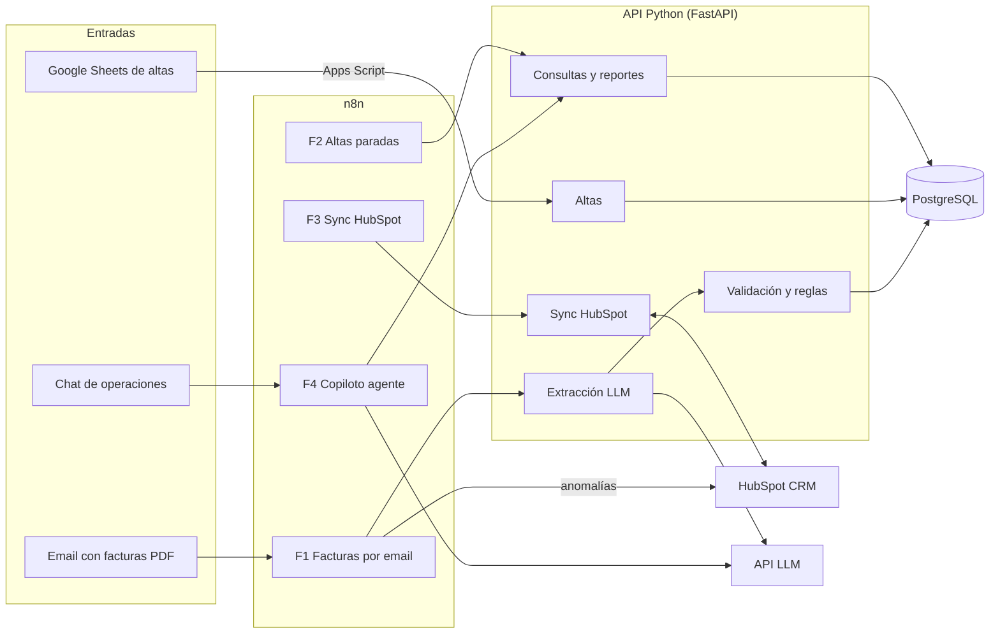

# Energy Ops Hub

[](https://github.com/aam9063/Energy-Ops-Hub/actions/workflows/ci.yml)

Automatización de operaciones energéticas para carteras inmobiliarias:
facturas PDF → extracción con LLM → reglas de anomalías → PostgreSQL → HubSpot.

Todos los datos del proyecto son **sintéticos** y todas las métricas de ahorro son
**estimaciones con supuestos explícitos**. No hay datos de personas ni empresas reales.

## El problema (30 segundos)

Javier gestiona los suministros de luz de varios clientes inmobiliarios: un build to rent con
200 viviendas, una cadena de oficinas y un operador logístico. Su día a día:

1. Le llegan por email **decenas de facturas en PDF** de varias comercializadoras, cada una con
   su formato. Las abre una a una, copia los datos a una hoja y revisa a ojo si algo no cuadra.
2. Un cliente le manda un Excel con **50 viviendas nuevas** y muchas filas vienen con el CUPS
   mal escrito. Se entera semanas después, cuando la solicitud se rechaza.
3. Lleva el estado de cada alta **en HubSpot y en su cabeza**; las que se atascan no las ve
   hasta que el cliente se queja.
4. Ventas le pregunta continuamente *"¿cuánto pagó este edificio el último trimestre?"*.

Energy Ops Hub ataca los cuatro: extrae y valida las facturas, detecta anomalías con reglas
ejecutables, crea las altas con validación previa en la hoja que ya usa el equipo y expone
consultas de cartera por API.

## Qué hace

- **Facturas**: un flujo de n8n escucha el buzón y manda cada PDF a la API. Un LLM
  (`gpt-4.1-mini`) lo convierte en un esquema fijo y **once reglas en código** detectan
  anomalías: duplicadas, totales que no cuadran, consumos disparados, lecturas estimadas
  seguidas, potencia distinta de la contratada, CUPS fuera de cartera… Las graves se crean
  como **tickets en HubSpot**.
- **Altas masivas**: el equipo trabaja en una hoja de Google con un menú de Apps Script que
  valida los CUPS **antes** de enviar nada; las altas válidas llegan por lote a la API y se
  crean como **negocios en HubSpot**, y un flujo diario avisa de las paradas más de 7 días.
- **Consultas**: endpoints de reportes por cliente y periodo, más tareas programadas
  (suministros activos sin facturar).

El guion de demo de 3 minutos está en [docs/demo.md](docs/demo.md) (el vídeo lo graba el
humano).

## Arquitectura



Python concentra toda la lógica de negocio y los tests; n8n solo orquesta (disparadores,
horarios y avisos); Apps Script valida en la hoja; HubSpot y PostgreSQL son las fuentes de
verdad. Detalle completo en [docs/arquitectura.md](docs/arquitectura.md).

> Nota honesta: los flujos F1, F2 y F3 están construidos y versionados en `n8n/`. El copiloto
> (F4) es una decisión de diseño documentada en el
> [ADR 0005](docs/adr/0005-copiloto-de-solo-lectura.md) pero **aún no está implementado**.

## Decisiones clave

| Decisión | ADR |
|---|---|
| Git con `main` y `dev`, CI obligatorio, merge a `main` humano | [ADR 0000](docs/adr/0000-flujo-git-main-dev.md) |
| Lógica de negocio en Python, orquestación en n8n | [ADR 0001](docs/adr/0001-logica-en-python-orquestacion-en-n8n.md) |
| Altas como negocios y anomalías como tickets en HubSpot | [ADR 0002](docs/adr/0002-altas-como-negocios-y-anomalias-como-tickets.md) |
| Polling incremental en lugar de webhooks para el MVP | [ADR 0003](docs/adr/0003-polling-incremental-en-lugar-de-webhooks.md) |
| LLM para extraer, código para validar | [ADR 0004](docs/adr/0004-llm-para-extraer-codigo-para-validar.md) |
| Copiloto de solo lectura | [ADR 0005](docs/adr/0005-copiloto-de-solo-lectura.md) |
| Sin interfaz propia: las herramientas que el equipo ya usa | [ADR 0006](docs/adr/0006-sin-interfaz-propia.md) |

## Resultados

Evaluación con la clave real de OpenAI (`gpt-4.1-mini-2025-04-14`) sobre las **120 facturas
sintéticas** del dataset. Fuente: [evals/resultados.md](evals/resultados.md); se regenera con
`uv run python -m evals.run_evals`.

**Precisión de la extracción** (comparación campo a campo contra la verdad esperada):

| Campo | Precisión |
|---|---:|
| CUPS | 100,0 % |
| Número de factura | 100,0 % |
| Comercializadora | 100,0 % |
| Periodo (inicio y fin) | 100,0 % |
| Consumo kWh | 100,0 % |
| Importe total | 100,0 % |
| Lectura estimada | 100,0 % |

**Detección de anomalías** (18 inyectadas a propósito en el dataset):

| Métrica | Valor |
|---|---:|
| Recall | **18/18 (100 %)** |
| Falsas alarmas | **10** |
| Coste medio por factura | **0,0007 €** |

Las 10 falsas alarmas se descomponen en 9 de R5 (*el total no cuadra*) por ±1 € de ruido de
extracción en los conceptos y 1 de R4 (*periodo solapado*) sobre una factura duplicada. El
coste por factura es una **estimación con la lista de precios en USD usada como EUR**, no una
conversión de divisa.

En cuanto a calidad del código: **219 tests** en pytest (los de integración usan PostgreSQL
real) y **97 % de cobertura sobre `app/`**, con `ci-ok` obligatorio en `dev` y `main`.

**Métricas de ahorro (estimación, no promesa).** Supuestos, todos discutibles:

- *Supuesto 1*: transcribir y revisar una factura a mano lleva unos **4 minutos**. Con
  **500 facturas al mes** son unas **33 horas al mes** de trabajo manual.
- *Supuesto 2*: según la evaluación, 10 de 120 facturas quedan marcadas para revisión humana;
  el **~92 %** del resto se procesaría sin intervención (dato medido sobre facturas
  sintéticas, no sobre producción).
- Con ambos supuestos, el ahorro bruto estimado sería de unas **30 horas al mes**
  (33 h × 0,92). En un entorno real habría que medir antes cuánto tarda hoy el equipo y qué
  proporción de facturas reales dispara reglas.

## Cómo ejecutarlo

Requisitos: Docker, [uv](https://docs.astral.sh/uv/) y una clave de OpenAI para la extracción
(`OPENAI_API_KEY` en el `.env`; sin ella, todo lo que no llame al LLM funciona igual).

```bash
cp .env.example .env          # y rellena OPENAI_API_KEY
docker compose up -d          # PostgreSQL + API + n8n
uv sync                       # dependencias de Python
uv run alembic upgrade head   # esquema de la base de datos
uv run python -m scripts.seed # clientes y suministros de ejemplo
```

La API queda en `http://localhost:8000` (documentación en `/docs`), n8n en
`http://localhost:5678`. Con `uv run pytest -q` corren los 219 tests. El dataset sintético
(`evals/dataset/`) no se versiona: se regenera con `uv run python -m scripts.generate_invoices`.

## Cómo se ha construido

Con agentes de IA, pero con un proceso de equipo (**ODD + RDD**):

- Cada feature tiene un documento en [`odd/tasks/`](odd/tasks/) con objetivo, alcance,
  checklist, criterios de aceptación, evidencia y resultado de revisión.
- Los tests van primero en el dominio (CUPS, reglas, idempotencia, cliente de HubSpot).
- Cada feature entra a `dev` por PR con squash merge y el check agregador `ci-ok` obligatorio
  (lint, tipos, tests con PostgreSQL real, validación de flujos de n8n y Apps Script,
  gitleaks y build de la imagen). Los cambios de riesgo medio o alto pasan además una revisión
  RDD antes de abrir el PR.
- El merge a `main` (releases) lo hace el humano.

| Feature | Documento ODD | PR |
|---|---|---|
| 01 · Base del proyecto | [odd/tasks/01-base-proyecto.md](odd/tasks/01-base-proyecto.md) | [#1](https://github.com/aam9063/Energy-Ops-Hub/pull/1) |
| 02 · Pipeline de CI | [odd/tasks/02-pipeline-ci.md](odd/tasks/02-pipeline-ci.md) | [#2](https://github.com/aam9063/Energy-Ops-Hub/pull/2) |
| 03 · Datos sintéticos | [odd/tasks/03-datos-sinteticos.md](odd/tasks/03-datos-sinteticos.md) | [#4](https://github.com/aam9063/Energy-Ops-Hub/pull/4) |
| 04 · Extracción con LLM | [odd/tasks/04-extraccion-facturas.md](odd/tasks/04-extraccion-facturas.md) | [#5](https://github.com/aam9063/Energy-Ops-Hub/pull/5) |
| 05 · Reglas de anomalías | [odd/tasks/05-reglas-anomalias.md](odd/tasks/05-reglas-anomalias.md) | [#6](https://github.com/aam9063/Energy-Ops-Hub/pull/6) |
| 06 · Evaluación del LLM | [odd/tasks/06-evals.md](odd/tasks/06-evals.md) | [#8](https://github.com/aam9063/Energy-Ops-Hub/pull/8) |
| 07 · Integración con HubSpot | [odd/tasks/07-hubspot.md](odd/tasks/07-hubspot.md) | [#9](https://github.com/aam9063/Energy-Ops-Hub/pull/9) |
| 08 · Altas desde Google Sheets | [odd/tasks/08-apps-script.md](odd/tasks/08-apps-script.md) | [#10](https://github.com/aam9063/Energy-Ops-Hub/pull/10) |
| 09 · Flujos de n8n | [odd/tasks/09-flujos-n8n.md](odd/tasks/09-flujos-n8n.md) | [#11](https://github.com/aam9063/Energy-Ops-Hub/pull/11) |
| 11 · CD y releases | [odd/tasks/11-cd-despliegue.md](odd/tasks/11-cd-despliegue.md) | [#12](https://github.com/aam9063/Energy-Ops-Hub/pull/12) |

La especificación completa del producto y de la técnica está en
[docs/spec.md](docs/spec.md).

## Limitaciones y siguientes pasos

- **El copiloto no está construido.** El flujo F4 y sus cinco pruebas (feature 10 del plan)
  quedan pendientes; la decisión de diseño (solo lectura) está en el
  [ADR 0005](docs/adr/0005-copiloto-de-solo-lectura.md).
- **Todo el dataset es sintético.** Los números de evaluación miden extracción sobre PDF
  generados con reportlab; con facturas reales de otras comercializadoras la precisión habrá
  que medirla de nuevo.
- **Solo luz.** Gas y agua quedan como siguiente paso: el modelo es extensible, pero las
  reglas y el esquema se diseñaron para facturas eléctricas.
- **Autenticación mínima**: una API key basta para la demo; no hay usuarios ni roles.
- **Despliegue real en Render.** La API corre en
  [energy-ops-hub-main.onrender.com](https://energy-ops-hub-main.onrender.com/health) con un
  PostgreSQL gestionado, desplegada desde la imagen de GHCR por el CD. El plan Free de la base
  caduca a los 30 días. No hay entorno de staging: `main` se despliega y `dev` no.
- **Métricas de ahorro no medidas**: son estimaciones con supuestos; el primer paso real
  sería medir el proceso actual del equipo.
- Siguientes pasos: feature 10 (copiloto), vídeo de demo, gas y agua, validación de consumos
  con Datadis y RAG de procedimientos para el copiloto.

## Si esto fuera a producción

- **Autenticación real** en la API (OAuth o SSO interno) en lugar de una API key compartida,
  y separación por cliente con auditoría.
- **Cola de trabajos** para el procesado de facturas (Celery o una cola gestionada) y
  reintentos con letra muerta, en lugar de procesado síncrono por petición.
- **Webhooks de HubSpot** en lugar de polling cada 15 minutos (ver
  [ADR 0003](docs/adr/0003-polling-incremental-en-lugar-de-webhooks.md)).
- **Datadis** para contrastar el consumo facturado con el registrado por la distribuidora.
- **Observabilidad**: trazas y métricas por comercializadora, alertas sobre la tasa de
  falsas alarmas y un panel de derivación a revisión humana.
- **Medir el proceso actual** del equipo antes de prometer ahorros, y definir con negocio el
  umbral de revisión humana (hoy 0,85 de confianza, ver
  [ADR 0004](docs/adr/0004-llm-para-extraer-codigo-para-validar.md)).
