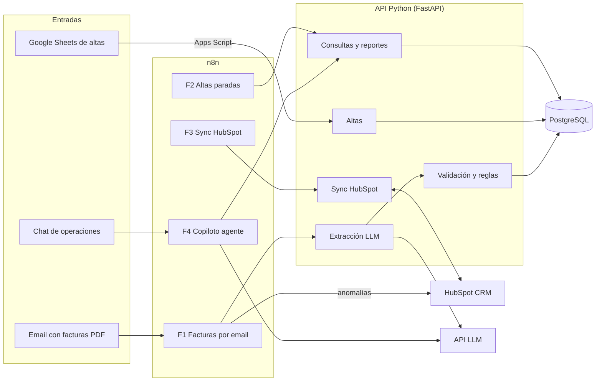

# Arquitectura · Energy Ops Hub

Fuente de verdad: [docs/spec.md](spec.md), secciones 4, 5 y 9 a 14. Este documento resume el
diagrama, el reparto de responsabilidades y los dos flujos principales.

## Diagrama

> El flujo F4 (copiloto) está diseñado y documentado en el
> [ADR 0005](adr/0005-copiloto-de-solo-lectura.md), pero **no está implementado todavía**
> (feature 10 del plan). Los flujos F1, F2 y F3 sí están versionados en `n8n/`.

## Reparto de responsabilidades

| Pieza | Responsabilidad | Qué no hace |
|---|---|---|
| **Python (API FastAPI)** | Toda la lógica de negocio: validación de CUPS, extracción con LLM, reglas R1–R11, altas, sincronización con HubSpot, reportes. Es lo que se testea (97 % de cobertura). | No dispara por tiempo ni escucha buzones: para eso está n8n. |
| **n8n** | Orquestación: disparar la API desde el email (F1), avisar de altas paradas (F2), sincronizar HubSpot cada 15 minutos (F3) y, en el futuro, el copiloto (F4). | Ninguna regla de negocio. Si una decisión vive en un nodo de n8n, no se puede testear igual ([ADR 0001](adr/0001-logica-en-python-orquestacion-en-n8n.md)). |
| **Apps Script** | La interfaz en la hoja del usuario: menú **Energy Ops** con «Validar filas» (formato de CUPS, obligatorios y duplicados, coloreado en rojo), «Enviar altas válidas» (lote a la API) y «Actualizar estados», más el informe diario por email. | No decide qué es un CUPS válido: reutiliza la misma lógica que la API y el envío siempre pasa por `POST /altas/lote`. |
| **HubSpot** | Fuente de verdad comercial: empresas (clientes), negocios del pipeline «Altas de suministro» y tickets de anomalías. El equipo mueve las fases ahí. | No guarda datos técnicos (consumos, lecturas, tarifas): eso vive en PostgreSQL. |
| **PostgreSQL** | Fuente de verdad técnica: clientes, suministros, facturas, anomalías y eventos de sincronización (`eventos_sync` para auditar). | — |

Regla transversal: **idempotencia siempre**. Las facturas se deduplican por hash del archivo y
clave de negocio; las altas, por CUPS; y los objetos de HubSpot se cruzan por IDs externos
guardados en nuestra base de datos. Reprocesar no duplica nada.

## Flujo de una factura

1. Llega un email con un PDF al buzón dedicado; el **Gmail Trigger del flujo F1** (n8n) descarga
   los adjuntos y llama a `POST {API_URL}/facturas` con el binario y la cabecera `X-API-Key`.
2. La API calcula el **hash del archivo**: si ya existe, devuelve el resultado anterior sin
   volver a llamar al LLM (idempotencia).
3. El servicio de extracción manda el texto del PDF al **LLM** pidiendo una salida estructurada
   con un esquema fijo (`FacturaExtraida`); la salida se valida con Pydantic.
4. Se ejecutan las **reglas de anomalías** (R1–R9 y R11) como funciones puras sobre la factura y
   su contexto (suministro e histórico). Resultado, anomalías y datos crudos se guardan en
   PostgreSQL.
5. Si hay anomalías de severidad alta, n8n llama a `POST /anomalias/{id}/ticket` y la API crea
   (de forma idempotente) el **ticket en HubSpot** asociado a la empresa, y avisa al equipo por
   email o Slack.
6. La regla R11 marca para **revisión humana** toda extracción con confianza por debajo de 0,85
   ([ADR 0004](adr/0004-llm-para-extraer-codigo-para-validar.md)).

## Flujo de un alta

1. Javier pega las filas en la hoja «Altas» de **Google Sheets** y usa el menú de Apps Script.
2. «**Validar filas**» comprueba en la propia hoja el formato del CUPS, los campos obligatorios
   y los duplicados, y marca en rojo las filas con error y su motivo. Nada sale de la hoja sin
   pasar este paso.
3. «**Enviar altas válidas**» manda solo las filas validadas a `POST /altas/lote`; la API valida
   de nuevo, hace upsert por CUPS, crea el **negocio en HubSpot** en el pipeline de altas y
   devuelve el resultado fila a fila.
4. El estado del alta lo mueve el equipo en HubSpot; el flujo **F3** sincroniza cada 15 minutos
   los negocios modificados de vuelta a `suministros.estado` (polling incremental,
   [ADR 0003](adr/0003-polling-incremental-en-lugar-de-webhooks.md)).
5. El flujo **F2** consulta cada mañana laborable `GET /altas?parada_dias=7` y avisa de las
   altas paradas más de una semana, agrupadas por cliente.
